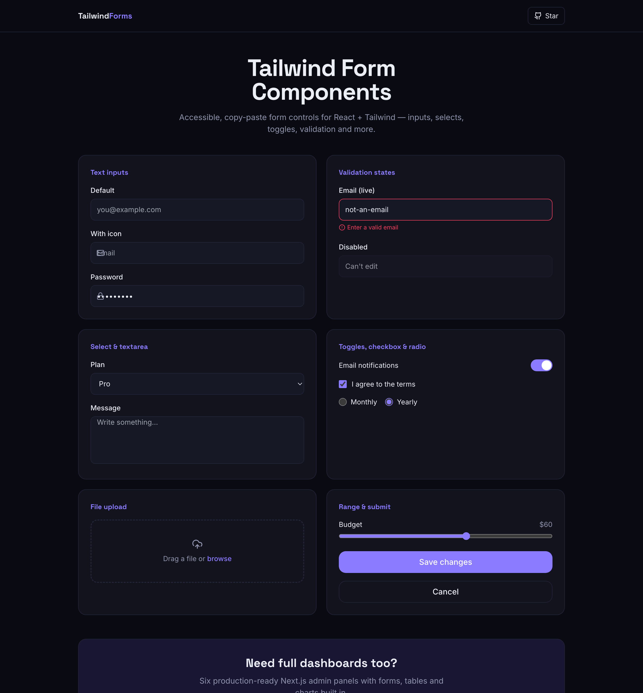

# Tailwind Form Components — Free Copy-Paste

Accessible, good-looking **form components** for **React + Tailwind CSS** — inputs, selects, textareas, checkboxes, radios, toggles, file upload, range and validation states. Copy, paste, ship. Dark mode included.




> ⭐ **Star the repo** if it saves you time.

## 🧩 Included

Text inputs · inputs with icons · password field · **live validation states** (error / success / disabled) · select · textarea · **toggle switch** · checkbox · radio group · **file upload dropzone** · range slider · button styles.

## 🚀 Quick Start

```bash
git clone https://github.com/omer-poyraz/tailwind-form-components.git
cd tailwind-form-components && npm install && npm run dev
```

Every control lives in `app/page.tsx` with small CSS helpers (`.inp`, `.lbl`) in `app/globals.css` — **copy the markup you need.** Colors are driven by CSS variables, so they match any theme.

---

## ⭐ Building the whole app?

These form controls power a full set of **production-ready Next.js dashboards**:

### 👉 [**Admin Templates Bundle — 6 dashboards for $99**](https://omerpoyraz.gumroad.com/l/nextjs-admin-bundle)  ·  [free admin starter](https://github.com/omer-poyraz/nextjs-admin-dashboard-starter)

E-commerce · CRM · SaaS metrics · Blog/CMS · Project manager · Help desk.

---

## 📄 License

MIT © [Ömer Poyraz](https://omerpoyraz.gumroad.com). Free for personal and commercial use.

## 🔖 Keywords

`tailwind forms` · `react form components` · `tailwind form` · `tailwind input` · `form components react` · `nextjs forms` · `tailwind css forms` · `form validation react`
